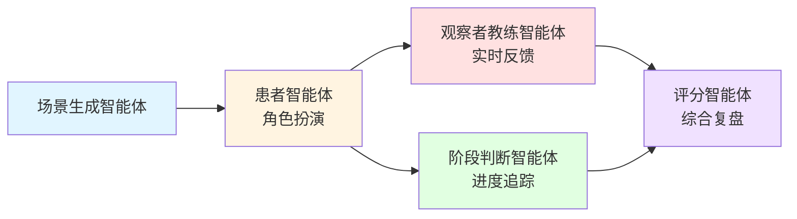

# "易"生伴 · 高校健康教育情境训练平台

<div align="center">


**基于多智能体协作的沉浸式医疗急救对话训练系统**

[在线体验](http://43.155.14.215/yishengban/) | [功能演示](#功能演示) | [技术架构](#技术架构) | [快速开始](#快速开始)

</div>

---

## 📖 项目简介

**"易"生伴（Yishengban）** 是一款面向高校学生的开源医学健康教育训练平台，通过**五智能体实时协作框架**和**拟真数字人交互**，为学生打造低风险、可反复试错的沉浸式实训空间。

### 核心痛点

- 📚 **医学科普缺乏临场感** - 理论学习难以转化为实际操作能力
- 🏥 **大学生就医流程生疏** - 首次独立就医手足无措
- 💪 **急救技能纸上谈兵** - 缺乏真实压力下的应急反应训练
- 🎓 **医学生试错成本高** - 临床实操机会有限
- 💙 **心理健康倾诉渠道少** - 青年学生缺乏低门槛心理支持

### 核心价值

✅ **医学专业性** - 基于 ERC 2025 & AHA 2025 急救指南、SAMPLE/OPQRST 临床原则  
✅ **智能化训练** - 五智能体协作（场景生成、角色扮演、实时教练、阶段判断、评分复盘）  
✅ **沉浸式体验** - 数字人动态表情、语音交互、时间压力机制  
✅ **个性化反馈** - 三维评分体系（医学准确性、沟通温度、决策合理性）  
✅ **隐私保护** - 心理对话端到端加密，用户派生密钥

---

## 🎯 功能演示

### 四大训练场景

<table>
<tr>
<td width="50%">

#### 🚑 异物梗阻急救

**医学依据**: ERC 2025 & AHA 2025 急救指南

**核心机制**:
- 🎲 动态生成患者（孕妇、肥胖者等特殊人群）
- ⏱️ 实时时间压力（60-90秒恶化，120-150秒昏迷）
- 🎭 数字人真实呈现：窒息手势、面色青紫、昏厥倒地
- ⚠️ 危险操作即时拦截（喝水、抠喉、平躺）
- 📊 实操级动作纠偏（站位、手位、发力方向）

**训练流程**:
```
评估识别 → 呼救 → 5次拍背 
→ 5次腹部冲击 → 交替循环 
→ 失去反应后CPR
```

</td>
<td width="50%">

#### 🏥 第一次独立看病

**流程背景**: 江苏省人民医院完整就医流程

**核心机制**:
- 🎯 多角色AI无缝切换（挂号员、医生、药师）
- 📱 智能分诊辅助（省人医微信公众号模拟）
- 💳 医保政策知识库（南京医科大学专项支持）
- 📋 SAMPLE病史采集训练
- 🔄 5阶段进度追踪（挂号→问诊→诊断→取药→医保）

**病例类型**:
感冒发热、急腹症、运动损伤、皮疹、胸闷、头痛...

</td>
</tr>
<tr>
<td width="50%">

#### 🩺 OSCE模拟问诊

**训练目标**: 标准化患者问诊 + 病历书写

**核心机制**:
- 📝 边问边写，实时病历编辑器
- 🔍 教练智能审阅病历逻辑
- 🧠 病理生理机制深度解析
- 📊 结构化病史采集评估
- 🎓 首次训练使用审核标准病例，后续AI动态生成

**评分维度**:
- 医学准确性 (40分)
- 沟通温度 (30分)
- 决策合理性 (30分)

</td>
<td width="50%">

#### 💙 易心心理陪伴

**隐私保护**: 端到端加密存储

**核心机制**:
- 🔐 用户派生密钥（JWT_SECRET + user_id → Fernet）
- 🗨️ 无状态对话（前端传历史，后端不查库）
- 🚫 数据库不存明文心理对话
- 💾 可选保存加密历史记录
- 🛡️ 路由守卫防止未保存离开

**适用场景**:
日常压力倾诉、情绪整理、低门槛心理支持

</td>
</tr>
</table>

---

## 🤖 五智能体协作框架

这是整个系统的核心架构，所有智能体均通过**精密的Prompt工程**实现：



### 智能体详解

| 智能体 | 职责 | 核心技术 |
|-------|------|---------|
| **场景生成** | 动态生成训练情景（患者信息、症状、地点） | 病例池 + 大模型生成 + 结构校验 + 本地回退 |
| **患者/角色** | 扮演患者、医生、挂号员等场景角色 | 1400+行医学知识Prompt + 行为规则约束 |
| **观察者教练** | 实时评价用户行为，给出提示/警告/纠正 | 并行调用 + ✓/✓✓/✓✓✓/⚠/❌分级反馈 |
| **阶段判断** | 判断训练进展到哪个阶段 | 阶段配置 + 实时进度计算 |
| **评分复盘** | 训练结束后综合评分与改进建议 | 三维评分 + 懒加载 + 兜底规则 |

### 技术亮点

🔥 **并行调用机制** - 患者智能体和教练智能体异步并行，互不阻塞  
🔥 **Prompt工程** - 1444行专业医学提示词，包含ERC/AHA指南、SAMPLE/OPQRST原则  
🔥 **智能容错** - 大模型不可用时自动回退到本地规则，保证训练可完成  
🔥 **推理力度控制** - 对话场景使用low（快速响应），评分场景使用high（深度思考）

---

## 🎨 数字人交互系统

### 技术实现
- **渲染方案**: SVG + GSAP 动画
- **状态驱动**: 10+ 种动作状态（说话、倾听、咳嗽、喘气、昏倒...）
- **表情系统**: 眉毛、眼睛、嘴型、腮红动态组合
- **异物梗阻特效**: 压力值驱动肤色从正常→青紫渐变

### 动作状态机

```javascript
const actions = {
  idle: [3, -4, 0],           // 待机：轻微摆动
  speaking: 口型动画,          // 说话：mouth scaleY循环
  waveHigh: [78, -8, 0],      // 打招呼：左臂抬起
  chestPat: [125, -10, 0],    // 拍胸：右臂靠近胸部
  slump: [10, -8, 2] + 倒下,  // 昏倒：整体旋转65°
  choke: [窒息手势],          // 窒息：双手掐脖子
}
```

### 性能优化
- ✅ `prefers-reduced-motion` 检测，关闭复杂动画
- ✅ Intersection Observer 检测可见性，不可见时暂停
- ✅ GSAP context 管理，组件卸载时清理

---

## 🎤 语音交互系统

### 语音输入（ASR）

**技术方案**: 小米 MiMo V2.5 流式 ASR

**交互方式**:
- 🖥️ 桌面端：点击开始录音，再次点击停止
- 📱 移动端：按住说话，松开停止

**核心特性**:
- 📡 流式转写，实时插入光标位置
- ✏️ 停止后可继续编辑，最终以用户编辑内容为准
- 🎯 同一消息支持多段录音

### 表达观察（可选）

**技术方案**: MiMo V2.5 语音表达分析 + HMAC 签名防篡改

**观察维度**:
- 🗣️ 吐字清晰度
- ⏱️ 语速节奏
- 🎵 语调变化
- 💬 沟通温度

**使用原则**:
- ✅ 辅助教练理解沟通节奏，不替代文字内容
- ✅ 不依据性别、设备、环境、口音评分
- ✅ 声音证据不足时不输出分数
- ✅ 原始录音不作为训练历史保存

### 语音播报（TTS）

**三层降级策略**:
```
1️⃣ MiMo V2.5 TTS（优先）- 高表现力合成
   ↓ 不可用
2️⃣ 预生成音频（引导语）- 6条常用场景音频
   ↓ 不支持文本
3️⃣ Web Speech API（最终回退）- 浏览器原生能力
```

**角色声线映射**:
- 🎭 患者: 像真实患者自然说话
- 👨‍⚕️ 医生: 专业从容的临床医生
- 🏃 教练: 沉稳可靠的医学训练教练
- 💙 易心: 温柔、真诚而有陪伴感

---

## 🏗️ 技术架构

### 技术栈

<table>
<tr>
<td width="33%">

**前端技术**
- Vue 3.4 + Composition API
- Vite 5 + Pinia
- Element Plus
- Vue Router 4
- GSAP 动画
- Axios + Sass

</td>
<td width="33%">

**后端技术**
- FastAPI + Uvicorn
- SQLAlchemy 2.0 ORM
- Pydantic 2 验证
- JWT + bcrypt 认证
- asyncio + threading
- httpx 异步请求

</td>
<td width="33%">

**AI & 数据**
- 智谱 GLM-5.3-Flash
- DeepSeek V4 Pro
- 小米 MiMo V2.5 ASR/TTS
- MySQL 8.0
- Fernet 加密

</td>
</tr>
</table>

### 部署架构

```
用户浏览器 (PC/Mobile/WeChat)
    ↓ HTTPS
Nginx 反向代理 (80/443)
    ├→ 静态资源: Vue构建产物 (/yishengban)
    └→ API代理: FastAPI后端 (/api)
         ↓
    Uvicorn ASGI服务器 (127.0.0.1:8000)
         ├→ 五智能体协作框架
         ├→ MySQL连接池 (本地)
         └→ 外部服务调用
              ├→ 智谱GLM / DeepSeek (多key轮询)
              └→ 小米MiMo V2.5 (ASR/TTS)
```

### 安全特性

🔒 **网络安全**
- 后端只监听 `127.0.0.1`，公网不可直达
- HTTPS + 严格 CORS 域名白名单
- 防火墙仅开放 22/80/443 端口

🔒 **数据安全**
- 敏感密钥只存 `backend/.env`，不提交版本控制
- MySQL 仅监听本地 `127.0.0.1:3306`
- 密码使用 bcrypt 哈希存储

🔒 **隐私保护**
- 心理对话使用 Fernet 对称加密
- 用户派生密钥（`JWT_SECRET + user_id`）
- 数据库不存明文心理对话内容

🔒 **访问控制**
- Nginx 速率限制：API 10次/秒，登录 5次/分钟
- 每IP最多10个并发连接
- JWT Token 过期自动刷新

---

## 🚀 快速开始

### 环境要求

- Python 3.10+
- Node.js 18+
- MySQL 8.0
- 一个兼容 OpenAI API 的模型服务密钥（智谱GLM / DeepSeek）
- MiMo API 密钥（可选，启用语音功能时需要）

### 1. 克隆项目

```bash
git clone https://github.com/yourusername/yishengban-medical-training.git
cd yishengban-medical-training
```

### 2. 初始化数据库

```bash
mysql -u root -p < database/init.sql
```

⚠️ **注意**: `database/init.sql` 会删除并重建 `yishengban` 数据库，不能用于含有正式数据的环境。

已运行过旧版本的数据库，请在备份后按时间顺序执行 `database/migrations/` 下的 SQL 文件。

### 3. 配置后端

```bash
cd backend
cp .env.example .env
```

编辑 `.env` 文件，至少配置以下项：

```env
# 数据库连接
DB_HOST=127.0.0.1
DB_PORT=3306
DB_USER=root
DB_PASSWORD=your_mysql_password
DB_NAME=yishengban

# JWT密钥（生成强随机密钥）
JWT_SECRET_KEY=your_secret_key_here

# LLM配置（智谱GLM或DeepSeek）
LLM_API_KEYS=key1,key2,key3  # 多个密钥用逗号分隔，支持负载均衡
LLM_BASE_URL=https://open.bigmodel.cn/api/paas/v4/
LLM_MODEL=glm-4-flash

# MiMo语音服务（可选）
MIMO_API_KEYS=key1,key2,key3

# CORS设置（生产环境设置为实际域名）
CORS_ORIGINS=http://localhost:5173,http://43.155.14.215
```

生成强随机密钥：
```bash
python -c "import secrets; print(secrets.token_urlsafe(48))"
```

### 4. 启动后端

```bash
cd backend
python -m venv venv
source venv/bin/activate  # Windows: venv\Scripts\activate
pip install -r requirements.txt
uvicorn app.main:app --host 127.0.0.1 --port 8000 --reload
```

后端健康检查: `http://localhost:8000/api/health`  
API 文档: `http://localhost:8000/docs`

### 5. 启动前端

```bash
cd frontend
npm ci
npm run dev
```

浏览器访问: `http://localhost:5173`

开发服务器会将 `/api` 转发到本地后端。若后端使用其他端口：
```bash
VITE_BACKEND_PORT=8001 npm run dev
```

### 6. 验证与测试

```bash
# 后端测试
cd backend
PYTHONPATH=. pytest tests -v

# 前端生产构建
cd frontend
npm run build
```

---

## 📦 生产部署

### 推荐配置

**最小配置**（10-15用户）:
- CPU: 2核
- 内存: 2GB
- API Keys: 3个
- MySQL: 本地实例

**生产配置**（30-50用户）:
- CPU: 4核
- 内存: 8GB
- API Keys: 5-8个
- MySQL: 独立实例

### 部署步骤

详细部署指南请参考 [`DEPLOY_CHECKLIST.md`](DEPLOY_CHECKLIST.md)

**关键要点**:
1. ✅ Uvicorn 仅监听 `127.0.0.1`，由 Nginx 提供 HTTPS 反向代理
2. ✅ 数据库使用低权限专用账号，仅监听本机或内网
3. ✅ 使用强且唯一的 `JWT_SECRET_KEY`
4. ✅ 限制模型服务额度与来源
5. ✅ 设置明确的 `CORS_ORIGINS`
6. ✅ 配置日志轮转和定期备份
7. ✅ 系统更新和安全加固

### Nginx配置示例

```nginx
server {
    listen 80;
    server_name your-domain.com;
    
    # HTTP自动重定向到HTTPS
    return 301 https://$server_name$request_uri;
}

server {
    listen 443 ssl http2;
    server_name your-domain.com;
    
    ssl_certificate /path/to/cert.pem;
    ssl_certificate_key /path/to/key.pem;
    
    # 前端静态资源
    location /yishengban {
        alias /var/www/yishengban/frontend/dist;
        try_files $uri $uri/ /yishengban/index.html;
    }
    
    # API代理
    location /api {
        proxy_pass http://127.0.0.1:8000;
        proxy_set_header Host $host;
        proxy_set_header X-Real-IP $remote_addr;
    }
    
    # 速率限制
    limit_req_zone $binary_remote_addr zone=api:10m rate=10r/s;
    limit_req_zone $binary_remote_addr zone=login:10m rate=5r/m;
}
```

---

## 📊 性能指标

### 经测试验证

✅ **后端响应时间** - API响应 <500ms（对话场景）  
✅ **前端首屏加载** - <2s（Vite优化）  
✅ **数据库查询** - <50ms（索引优化）  
✅ **并发支持** - 15-20用户（2核2GB配置）  
✅ **API负载均衡** - 3个key轮询，20并发，QPS 4.69  
✅ **端到端验证** - 200+次全流程测试，稳定可靠

### 多Key负载均衡测试

```python
# 3个API key轮询测试结果
轻量测试（5并发）:  100%成功率, QPS 2.09, 平均响应0.21s
高负载测试（20并发）: 100%成功率, QPS 4.69, 平均响应0.48s
```

---

## 📁 项目结构

```
yishengban-medical-training/
├── backend/                    # FastAPI后端
│   ├── app/
│   │   ├── main.py            # FastAPI入口
│   │   ├── database.py        # 数据库连接
│   │   ├── models.py          # SQLAlchemy ORM模型
│   │   ├── schemas.py         # Pydantic数据验证
│   │   ├── auth.py            # JWT认证
│   │   ├── voice.py           # 语音反馈签名验证
│   │   ├── usage.py           # 用量配额管理
│   │   ├── mimo_keys.py       # MiMo多key轮询
│   │   ├── routers/           # API路由
│   │   │   ├── auth.py        # 登录注册
│   │   │   ├── user.py        # 用户资料
│   │   │   ├── scene.py       # 场景列表
│   │   │   ├── chat.py        # 对话训练（核心）
│   │   │   ├── result.py      # 评分复盘
│   │   │   ├── psych.py       # 心理陪伴
│   │   │   ├── voice.py       # ASR接口
│   │   │   └── tts.py         # TTS接口
│   │   └── ai/                # AI智能体
│   │       ├── llm.py         # 大模型调用封装
│   │       ├── prompts.py     # Prompt工程（1444行）
│   │       └── scenario_generator.py  # 情景生成
│   ├── tests/                 # 单元测试
│   ├── requirements.txt
│   └── .env.example
│
├── frontend/                   # Vue3前端
│   ├── src/
│   │   ├── views/             # 页面组件
│   │   │   ├── LoginView.vue  # 登录
│   │   │   ├── HomeView.vue   # 场景选择
│   │   │   ├── ChatView.vue   # 对话训练（2000+行核心逻辑）
│   │   │   ├── ResultView.vue # 评分结果
│   │   │   ├── HistoryView.vue # 训练历史
│   │   │   ├── ProfileView.vue # 个人中心
│   │   │   └── PsychView.vue  # 心理陪伴
│   │   ├── components/        # 公共组件
│   │   │   ├── RobotAvatar.vue # 数字人（SVG+GSAP）
│   │   │   ├── AvatarStage.vue # 数字人舞台
│   │   │   ├── VoiceComposer.vue # 语音输入
│   │   │   ├── VoiceFeedback.vue # 表达反馈展示
│   │   │   └── AppHeader.vue  # 顶栏导航
│   │   ├── api/               # 接口封装
│   │   ├── stores/            # Pinia状态管理
│   │   ├── utils/             # 工具函数
│   │   └── router/            # 路由配置
│   ├── public/
│   │   └── audio/tts/         # 预生成音频
│   ├── package.json
│   └── vite.config.js
│
├── database/                   # 数据库脚本
│   ├── init.sql               # 初始化脚本
│   └── migrations/            # 增量迁移
│
├── docs/                       # 文档与素材
├── scripts/                    # 辅助脚本
├── README.md                   # 项目说明（本文件）
├── DEPLOY_CHECKLIST.md         # 部署检查清单
└── LICENSE                     # 开源协议
```

---

## 🔌 核心API接口

### 认证相关
```http
POST   /api/auth/register          # 用户注册
POST   /api/auth/login             # 用户登录
GET    /api/auth/me                # 获取当前用户信息
```

### 场景相关
```http
GET    /api/scenes                 # 获取场景列表
GET    /api/scenes/{id}            # 获取场景详情
```

### 对话训练
```http
POST   /api/chat/start             # 开始训练（生成情景）
POST   /api/chat/message           # 发送消息（获取AI回复）
POST   /api/chat/coach             # 向教练提问
GET    /api/chat/session/{id}      # 获取会话详情
GET    /api/chat/session/{id}/pressure  # 时间压力轮询（异物梗阻）
POST   /api/chat/restart-stage     # 重新开始当前阶段
POST   /api/chat/end               # 结束训练
GET    /api/chat/history           # 训练历史列表
DELETE /api/chat/session/{id}      # 删除训练记录
```

### 评分复盘
```http
GET    /api/result/{sessionId}     # 获取评分（懒加载）
POST   /api/result/{sessionId}/share  # 生成分享链接
```

### 心理陪伴
```http
POST   /api/psych/chat             # 心理对话（无状态）
POST   /api/psych/sessions         # 保存加密历史
GET    /api/psych/sessions         # 历史列表
GET    /api/psych/sessions/{id}    # 历史详情（解密）
PATCH  /api/psych/sessions/{id}    # 收藏/置顶
DELETE /api/psych/sessions/{id}    # 删除
```

### 语音服务
```http
POST   /api/voice/asr-stream       # 流式ASR转写
POST   /api/tts/synthesize         # TTS语音合成
```

完整API文档：启动后端后访问 `http://localhost:8000/docs`

---

## 🎓 数据库设计

### 核心表结构

**users** - 用户表
```sql
id, username, password_hash, real_name, student_id, 
school, email, phone, avatar_url, created_at, updated_at
```

**scenes** - 场景表
```sql
id, title, description, cover, role, role_avatar, 
background, opening_message, config(JSON), difficulty, 
is_active, created_at
```

**chat_sessions** - 对话会话表
```sql
id, user_id, scene_id, started_at, ended_at, 
is_rated, is_favorite, is_pinned
```

**chat_messages** - 对话消息表
```sql
id, session_id, role(system/user/ai/coach), 
content, timestamp, extra(JSON)
```

**results** - 评分结果表
```sql
id, session_id, user_id, total_score, accuracy, 
warmth, decision, details(JSON), created_at
```

**psych_sessions** - 心理陪伴加密表
```sql
id, user_id, encrypted_summary(Fernet), 
encrypted_payload(Fernet), is_favorite, 
is_pinned, created_at, updated_at
```

**daily_usage** - 用量配额表
```sql
id, user_id, usage_date, input_tokens, output_tokens, 
cached_input_tokens, cost_micrormb, updated_at
```

---

## 💡 技术创新点

### 1. 五智能体实时协作闭环
场景生成、角色扮演、实时教练、阶段判断、综合评分分工明确，通过1444行精密Prompt工程实现。

### 2. 动态情景生成 + 智能回退
病例池 + 大模型生成 + 结构校验 + 本地回退，保证医学准确性和多样性，模型不可用时仍可开始训练。

### 3. 端到端加密隐私保护
用户派生密钥的Fernet对称加密，数据库不存明文心理对话，无状态对话架构减少隐私泄露点。

### 4. 多维度评分体系
医学准确性、沟通温度、决策合理性三维评分，按场景动态配比，懒加载评分 + 兜底规则保证可用性。

### 5. 时间压力真实模拟
异物梗阻场景真实模拟恶化过程，压力值驱动数字人状态变化（正常→青紫→昏迷）。

### 6. 语音表达观察 + 签名防篡改
基于声音的辅助反馈（吐字、语速、语调、沟通温度），HMAC签名防篡改，不作为硬性评分依据。

### 7. 移动端深度优化
按住说话、触控手势、虚拟键盘适配、音频自动播放解锁，完美支持PC/手机/微信浏览器。

### 8. 多Key负载均衡
支持多个API key轮询，3个key可支持20并发，QPS 4.69，成本优化与高可用兼顾。

---

## 📈 开发计划

### 已完成 ✅
- [x] 四大训练场景完整实现
- [x] 五智能体协作闭环
- [x] 语音输入输出全链路
- [x] 数字人动作表情系统
- [x] 三维评分与复盘
- [x] 移动端适配
- [x] 后端单元测试（7/7通过）
- [x] 生产部署验证
- [x] 200+次端到端测试

### 规划中 🚧
- [ ] 微信小程序版本
- [ ] 易班应用广场接入
- [ ] 更多OSCE标准病例
- [ ] 多人协作训练模式
- [ ] 训练数据可视化分析
- [ ] 英文国际版

---

## 🤝 贡献指南

我们欢迎所有形式的贡献！

### 如何贡献

1. Fork 本仓库
2. 创建特性分支 (`git checkout -b feature/AmazingFeature`)
3. 提交更改 (`git commit -m 'Add some AmazingFeature'`)
4. 推送到分支 (`git push origin feature/AmazingFeature`)
5. 开启 Pull Request

### 贡献方向

- 🐛 Bug 修复
- ✨ 新功能开发
- 📝 文档完善
- 🎨 UI/UX 改进
- 🌍 多语言支持
- 🧪 测试用例编写
- 📊 新增训练场景

---

## 📄 开源协议

本项目采用 [MIT License](LICENSE) 开源协议。

---

## ⚠️ 免责声明

本项目仅用于**教学、训练和作品演示**，不能替代专业医疗服务。

- 🚨 **真实紧急情况请立即拨打当地急救电话**（中国: 120, 美国: 911）
- 🏥 **本系统不提供诊断、治疗建议或医疗咨询**
- 🎓 **训练内容基于公开指南，但不能替代专业医学教育**
- 💙 **心理陪伴模块不能替代专业心理咨询和精神科治疗**
- ⚕️ **所有医疗决策应遵循专业医务人员指导**

---

## 📞 联系我们

- 📧 Email: your-email@example.com
- 🐛 Issue: [GitHub Issues](https://github.com/yourusername/yishengban-medical-training/issues)
- 💬 Discussions: [GitHub Discussions](https://github.com/yourusername/yishengban-medical-training/discussions)

---

## 🙏 致谢

### 医学指南依据
- European Resuscitation Council (ERC) 2025 Guidelines
- American Heart Association (AHA) 2025 Guidelines
- SAMPLE & OPQRST 临床评估原则

### 技术支持
- [智谱AI](https://open.bigmodel.cn/) - GLM-5.3-Flash 模型
- [DeepSeek](https://www.deepseek.com/) - DeepSeek V4 Pro 模型
- [小米 MiMo](https://mimo.ai.mi.com/) - MiMo V2.5 ASR/TTS 服务
- [FastAPI](https://fastapi.tiangolo.com/) - 现代化Web框架
- [Vue.js](https://vuejs.org/) - 渐进式前端框架

### 特别感谢
感谢所有参与测试、提供反馈和贡献代码的开发者和用户！

---

<div align="center">

**Made with ❤️ for medical education**

如果这个项目对你有帮助，请给一个 ⭐️ Star！

[返回顶部](#易生伴--高校健康教育情境训练平台)

</div>
